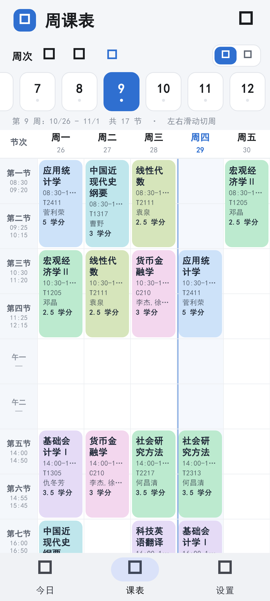
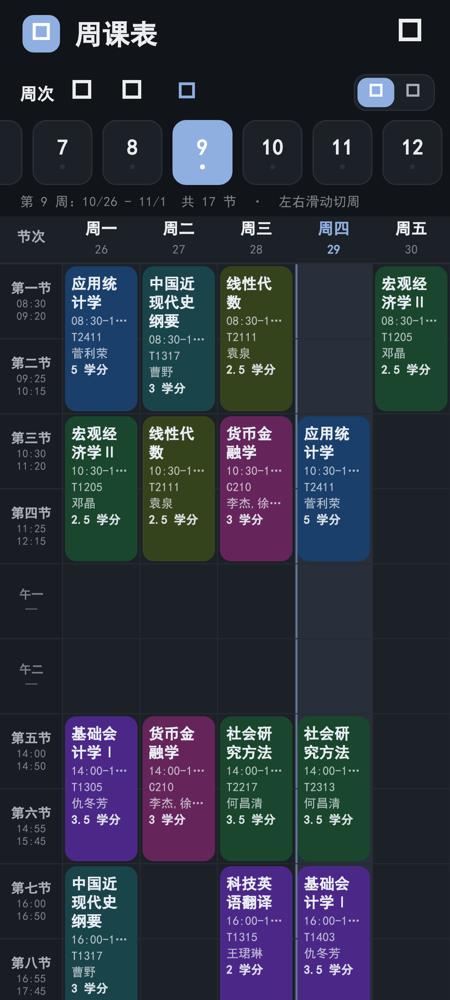
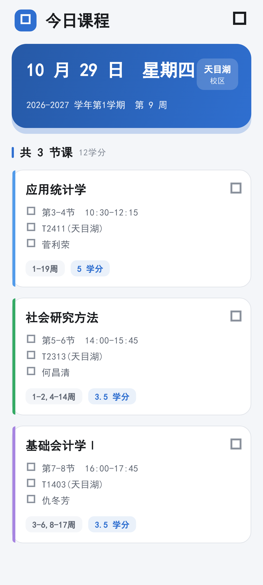
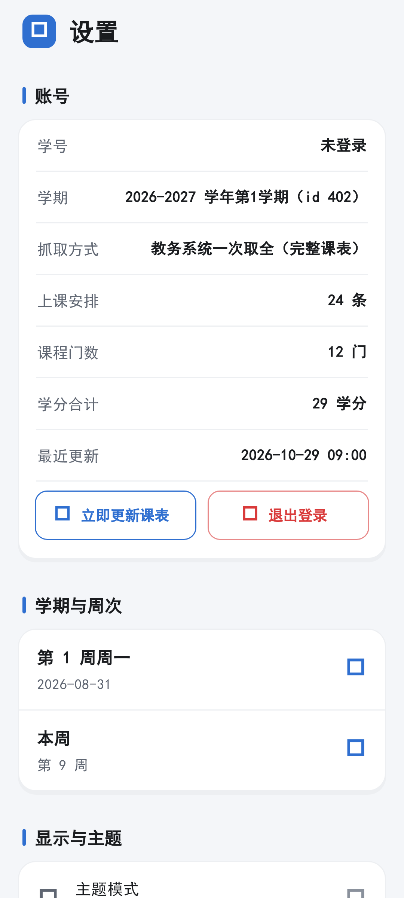

# 南航课程表 · nuaa_timetable

> 南京航空航天大学课程表的**非官方** Android 客户端。统一身份认证登录、教务课表同步、
> 周视图、上课提醒、深色模式与桌面小组件。


## ⚠️ 免责声明

**请在使用或分发前完整阅读。**

1. 本项目为个人学习与 Flutter 工程实践项目，**与南京航空航天大学及其教务处无任何隶属或授权关系**。
2. 应用通过学校公开的统一身份认证页面与教务系统接口获取**使用者本人的**课表数据，
   不采集、不上传、不共享任何第三方数据。凭据仅以明文保存在本机
   （与原客户端行为一致），不会离开设备。
3. 自动化访问教务系统**可能**与学校的信息系统使用条款存在冲突。是否使用由你自行判断并承担风险，
   作者不对因使用本软件导致的账号异常、纪律处分或其他后果负责。
4. 仓库**不包含**任何教务系统数据、校园网资源、原始客户端安装包或其反编译产物。
5. 本项目不得用于商业用途。若权利人认为内容不当，请通过 Issue 联系，将及时处理。

## 功能

| 模块 | 说明 |
|---|---|
| 登录 | CAS 统一身份认证，自动解析登录页参数并完成 AES 加密提交 |
| 课表 | 一次抓取整学期；失败时自动降级为逐周抓取并合并周次 |
| 今日 | 渐变日期卡 + 当日课程卡，含节次、时间、地点、教师、学分 |
| 周视图 | 左右滑动切周（跟手 + 吸附）、周次数字条、课表 / 列表双模式 |
| 学分 | 从课表响应附带的「课程列表」解析学分与课程类别，按课程去重统计 |
| 主题 | 6 套主题色 × 明暗三态（浅色 / 深色 / 跟随系统） |
| 提醒 | 按课程校区作息，提前 N 分钟本地通知 |
| 小组件 | Android 桌面 AppWidget，换日 / 下课时 / 更新课表后自动刷新 |
| 作息 | 按校区区分：将军路 / 明故宫 08:00 起，天目湖 08:30 起、7-8 节 16:00-17:45 |

## 截图

| 周课表（浅色） | 周课表（深色） | 今日课程 | 设置 |
|---|---|---|---|
|  |  |  |  |

> 截图为真实教务数据渲染（学号、姓名已脱敏）。

## 下载与安装

从 [Releases](../../releases) 下载最新 APK：

| 文件 | 适用 |
|---|---|
| `nuaa_timetable-arm64.apk` | 约 22 MB，绝大多数机型（推荐） |
| `nuaa_timetable-universal.apk` | 约 56 MB，含全部 ABI |

**安装前必须卸载旧版**（本包使用 debug 签名，与学校原版签名不同，覆盖安装会失败）：

```bash
adb uninstall cn.edu.nuaa.nuaa_timetable
adb install -r nuaa_timetable-arm64.apk
```

> 卸载会清除本机保存的学号、密码与课表缓存，需重新登录。

## 快速开始

### 环境

| 组件 | 版本 |
|---|---|
| Flutter | 3.47.8（Dart 3.13.7） |
| JDK | 17 |
| Android SDK | platform 36 / build-tools 36.0.0 |

### 构建

```bash
flutter pub get
flutter analyze
flutter test

flutter build apk --release --target-platform android-arm64  # 单 ABI，约 22 MB
flutter build apk --release                                 # 通用包，约 56 MB
```

> ⚠️ **不要用 `--split-per-abi`**：AGP 9 + Flutter 3.47 组合下其 arm64 产物会缺失
> `AndroidManifest.xml` 与 `resources.arsc`（装不上），而 v7a 产物却正常。
> 出包后自检：`unzip -l <apk> | grep -cE "AndroidManifest.xml|resources.arsc"` 应为 `2`。

### 联调

`tool/live_probe.dart` 用与 App 完全相同的网络层与解析器跑一遍真实链路，逐步打印
状态码、跳转 `Location`、Cookie 与解析结果：

```bash
NUAA_USER=<学号> NUAA_PW=<密码> dart run tool/live_probe.dart
```

凭据只从环境变量读取，不会落盘。

## 项目结构

```
lib/
├─ core/
│  ├─ config/app_config.dart     域名、路径、UA、超时（契约常量集中处）
│  ├─ crypto/pwd_encryptor.dart  AES-128-CBC，key=pwdEncryptSalt，明文=64 位随机前缀+密码
│  ├─ network/http_session.dart  手工跟随 302 + Cookie 收集（含 https→http 降级处理）
│  └─ time/period_table.dart     13 行节次（4 + 午一/午二 + 7）与两套校区作息
├─ data/
│  ├─ models/                    Semester / CourseSession / TimetableSnapshot
│  ├─ parsers/                   CAS 登录页、课表入口、TaskActivity 课表解析
│  ├─ repositories/              auth / eams（含逐周降级）/ timetable（缓存）
│  └─ campus_resolver.dart       地点 → 校区
├─ features/
│  ├─ auth/                      登录页
│  ├─ home/                      周视图网格、课程详情、手势门控
│  ├─ today/                     今日课程
│  ├─ settings/                  主题、提醒、作息、数据管理
│  └─ notifications/             通知渠道与提醒排期
├─ theme/                        唯一颜色源（ThemeExtension）
├─ state/                        AppController + AppScope（InheritedNotifier）
└─ widget_bridge/                小组件 payload 预计算 + MethodChannel

android/app/src/main/kotlin/.../widget/   Provider / Renderer / Store / AlarmScheduler
test/                                     91 项单元与 Widget 测试
docs/                                     逆向分析、深色修复、小组件协议、实施方案
```

## 关键实现

以下几处是踩坑后固化下来的约定，改动前建议先读对应文档。

**周次位图偏移。** 教务下发的 `weeks` 是 53 字符定长字符串，第 0 个字符是「第 0 周」占位，
真正的第 1 周在第 1 个字符（`索引 i = 第 i 周`）。早期按「第 0 位 = 第 1 周」解析，
导致全部课程整体延后一周。现按「位图长度明显大于学期周数即跳过第 0 位」判定，
紧凑位图仍按原样处理。回归用例见 `test/parsers/course_table_parser_test.dart` 的
「与教务页面逐门对照」分组。

**横竖手势分离。** `PageView` 内建拖拽已关闭，改由自定义的
`_StrictHorizontalDragRecognizer` 接管，额外要求「横向位移 ≥ 纵向 × 1.35」。
默认识别器只比较横向位移与 touchSlop，而人手上下滑必然带横向分量，
横向抢先接受后纵向滚动会被踢出竞技场，表现为「上下滑卡手」。

**课程配色对比度。** 8 个课程底色统一压到同一感知亮度（浅色 L≈0.74 / 深色 L≈0.048），
浅色下对白底 1.33:1、对正文 11:1。阈值由 `test/theme/contrast_test.dart` 固化。
注意不能用固定 HSL 亮度调色——黄绿色相同 HSL 亮度下感知亮度高得多。

**颜色单一来源。** `lib/` 下除 `theme/` 外禁止出现 `Colors.black`、`Color(0xFF…)`，
由 `test/theme/theme_guard_test.dart` 静态扫描强制，避免深色模式「深底深字」。

**小组件数据通道。** 不使用 shared_preferences 传递（新版走 DataStore，原生读不到），
改为 MethodChannel + 独立 JSON 文件；刷新三层兜底：30 分钟周期、午夜换日与下课时刻的
精确闹钟、系统事件与 App 内主动同步。

## 文档

| 文档 | 内容 |
|---|---|
| [`docs/REVERSE_ENGINEERING.md`](docs/REVERSE_ENGINEERING.md) | 逆向分析：构建指纹、接口契约、解析规则、校历推断、不可还原边界 |
| [`docs/WIDGET.md`](docs/WIDGET.md) | 桌面小组件数据协议、刷新策略、布局约束 |
| [`docs/DARK_MODE_FIX.md`](docs/DARK_MODE_FIX.md) | 深色模式弹窗文字不可见的成因与防回归手段 |
| [`docs/IMPLEMENTATION_PLAN.md`](docs/IMPLEMENTATION_PLAN.md) | 实施方案与风险登记 |
| [`ARTIFACTS.md`](ARTIFACTS.md) | 目录索引：源码 / 文档 / 制品 / 证据，说明哪些可删 |
| [`CHANGELOG.md`](CHANGELOG.md) | 版本变更记录 |
| [`CONTRIBUTING.md`](CONTRIBUTING.md) | 贡献指南与代码约定 |


## 许可

[MIT](LICENSE)。仅覆盖本项目作者编写的源码与文档，详见 LICENSE 末尾的补充说明。
